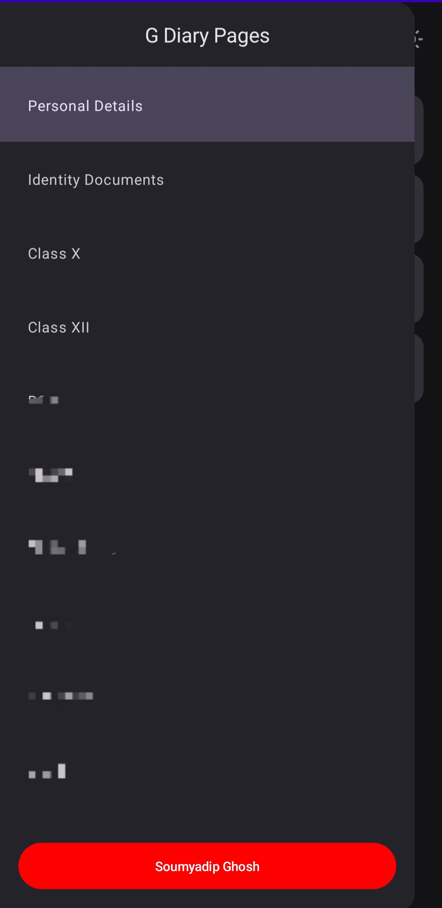
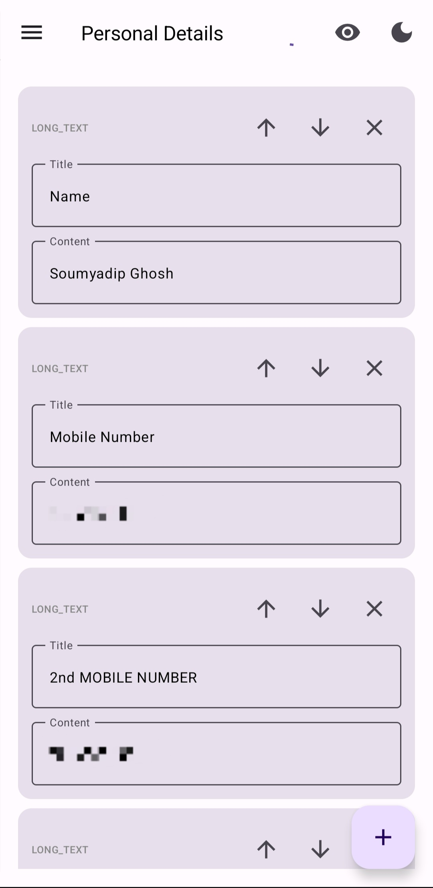
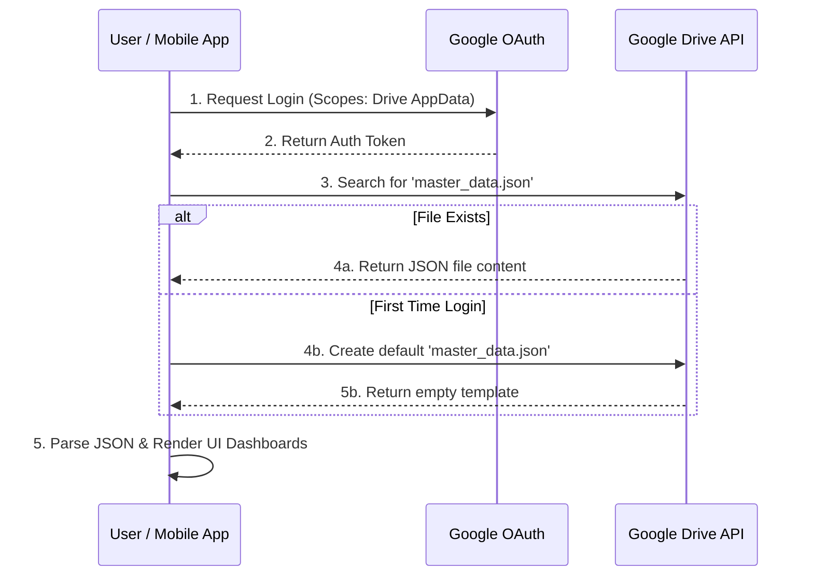
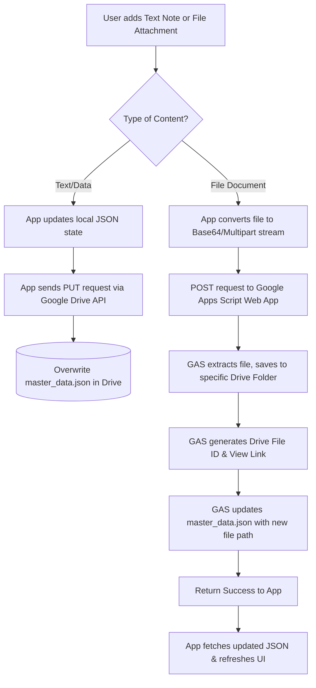

# 📓 G-Diary: Secure Personal & Document Organizer

> A personalized, secure mobile application that transforms a user's Google Drive into a dynamic, structured database and file management system. 

## 📱 About The Project

**G-Diary** is a mobile application designed to help users comprehensively organize their personal details, educational records, professional documents, and daily notes. 

Instead of relying on a traditional paid backend database (like Firebase or AWS), this application uses a highly efficient, zero-cost architecture by leveraging **Google APIs, Google Apps Script, and Google Drive storage**. All data and files remain entirely under the user's control within their own Google account, ensuring maximum privacy and security.

### 📸 App Gallery

| Navigation & Categories | Custom Data Entry | Content Modalities |
|:---:|:---:|:---:|
|  |  |  |
| *Dynamic page creation, reordering, and deletion.* | *Custom text fields for personal details.* | *Options to add text notes or file attachments.* |

*(Note: Add your actual screenshot files to your repo and update the `src` links above)*

---

## 🏗️ System Architecture & Strategy

Because the source code for this repository is kept private to protect proprietary logic, this section outlines the engineering strategy used to build the application.

The core challenge was creating a relational-style database and file storage system without using external paid servers. The solution relies on a **Master JSON architecture** combined with a **Serverless Google Apps Script (GAS) API**.

### System Workflow Graphs

#### 1. App Initialization & Authentication Flow
This diagram illustrates how the app securely authenticates the user and fetches the initial state without passing through any third-party servers.

#### 2. Data Modification & File Upload Flow
This diagram shows how user actions (adding a document or text note) are processed using Google Apps Script as a middle-tier to handle complex file-path extraction and JSON manipulation.

---

## ✨ Key Features & Capabilities

### 1. 📂 Dynamic Data Structuring
* **Custom Pages:** Users can create custom categories (e.g., *Identity Documents, Class X, BCA, Business*).
* **Flexible UI Elements:** Within each page, users can dynamically generate custom cards containing specific Titles and Content.
* **Granular Control:** Complete CRUD (Create, Read, Update, Delete) functionality for every single page and sub-section. 
* **Ordering:** Built-in up/down arrows allow users to sort their data precisely how they want it.

### 2. 📄 Advanced File Management
* **Dual Modality:** Users can insert simple "Text Notes" or upload "File Attachments" (PDFs, Images, Docs).
* **Smart Extraction:** The Google Apps Script backend automatically organizes uploaded files into designated sub-folders within the user's Drive, extracting the direct viewing/download links to display inside the app.

### 3. ☁️ Cloud Sync & State Management
* Because the app relies on a central `master_data.json` file in Google Drive, the user's state is perfectly synchronized. Logging into the app on a new device instantly restores the exact folder structure, order, and files.

### 4. 🌓 Modern UI/UX
* Clean, distraction-free interface.
* Full support for system-level Light and Dark modes.

---

## 💻 Tech Stack

* **Frontend App:** [Insert your frontend framework here, e.g., Flutter, React Native, Kotlin, Java]
* **Backend API / Middle-tier:** Google Apps Script (JavaScript)
* **Database:** JSON Document mapping
* **Storage:** Google Drive Storage (Google Drive API v3)
* **Authentication:** Google Sign-In / OAuth 2.0

---

## 🔒 Privacy & Data Security (Zero-Knowledge Architecture)

A core philosophy of G-Diary is **Absolute User Data Ownership**. 

* **No Central Server:** The application developer has absolutely zero access to user data.
* **App Data Folder:** The app utilizes the Google Drive restricted scopes, meaning it only has permission to view and manage files *created by the app itself*, protecting the rest of the user's Google Drive.
* **Direct Connection:** Data flows directly from the user's mobile device to their own personal Google Drive. No intermediary databases (like Firebase, MongoDB, or AWS) are used to store personal details.

---

## 👨‍💻 Developer

**[Your Name / Soumyadip Ghosh]**
* **GitHub:** [@rotten-repo](https://github.com/rotten-repo)
* **LinkedIn:** [Soumyadip Ghosh](https://linkedin.com/in/smdp)

> **Note to Recruiters & Collaborators:** 
> The source code for this application is currently held in a private repository to protect the proprietary integration methods used between the Frontend and Google Apps Script. If you are interested in a technical deep dive, viewing the codebase, or a live demonstration, please contact me directly.